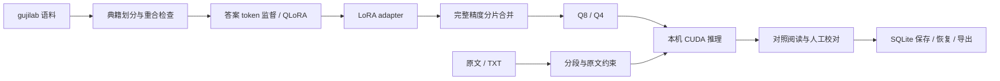

# Qwen3 文言文微调与本地研读

面向古籍辅助阅读的本地工具：用 Qwen3-4B 完成原文保真断句和古今互译，支持导入 TXT、逐段校对、保存结果、中断后继续处理及导出。模型训练、推理与阅读数据均可在本机完成。

技术栈：**PyTorch · Transformers · PEFT / QLoRA · FastAPI · SQLite**。已验证设备为 RTX 4060 Laptop 8GB，默认使用 `clean_2k_seed24` 的 Q8 部署产物。


## 主要能力

- **原文约束断句**：把输入原文编译成解码语法，只开放标点插入，并独立检查输出完整性，减少改字、漏字和续写。
- **领域微调与受控评测**：沿用 gujilab 语料，按典籍划分、去重和检查训练/测试重合；仅监督答案 token，完成两次固定种子的 QLoRA 实验。
- **本地量化推理**：从完整精度基座与 LoRA 分片合并，导出同 checkpoint 的 Q8/Q4 并比较；原生 CUDA 后端提供断句约束，HF NF4 后端可用于诊断。
- **可继续的阅读流程**：SQLite 保存原文、已完成段及人工修订；刷新或服务重启后可以恢复，未完成段重新生成；revision 检查防止旧页面覆盖新校对。
- **单卡任务管理**：实际生成并发 1，等待容量 4；提供进度、取消、超时和 OpenAI 兼容的非流式/SSE 聊天接口，使用真实 token usage。



## 已测结果与边界

相同微调 Q8、相同输入与生成预算下，比较自由生成和输入约束生成。下表为开发选择后冻结的增量保留断句集，bench/ood 各 20 条；它来自现有来源语料，不是新建独立 benchmark，参考没有逐题专家校点认证。

|题组|自由生成严格 F1|原文约束严格 F1|约束完整正文一致率|
|---|---:|---:|---:|
|bench|0.6829|0.8291|100%|
|ood|0.8172|0.9094|100%|
|全部样本均值|**0.7501**|**0.8693**|**100%**|

严格断句 F1 在正文变化时记 0，否则比较标点边界；它不是标点类型或语义准确率。**上表是解码策略收益，不是微调前后的收益**。正文一致是约束契约，不代表语义断句正确、引号平衡或翻译正确。

开发集补充了两示例基座对照，说明更强提示会缩小与微调模型的差距。Q8/Q4 对照、原始输出、协议、双种子结果和真实服务验收见 [验证报告](reports/validation/REPORT.md)。尚未完成独立人类翻译盲评，不能宣称语料完全无误、无灾难性遗忘或 Q4 全任务质量损失低于某个比例。

本机 500 / 1500 / 3000 字各一次的完整处理耗时约 12.83 / 34.96 / 69.55 秒，包含分段、推理和保存，仅是有限工作负载观测，不是 P95 或生产 SLA。

## 目录

```text
api/                  FastAPI、鉴权、任务接口与阅读页面
classical/            数据准备、训练、评分、约束、推理及文档保存
configs/              数据审核与实验检查配置
deploy/               可选的 Ollama 模型注册模板
scripts/              启停、导出、评测及真实服务检查
tests/                程序检查（部分需要另备本地资产）
reports/validation/   选定的当前结果、协议和验收记录
reports/gguf-artifacts.json  已测 GGUF 的大小、格式与 SHA-256
```

仓库不分发基座、adapter、GGUF、原始语料、运行数据库、访问令牌、下载工具和缓存。克隆后需要另外准备这些资产，不能直接启动已有模型。

## 环境与资产准备

已验证 Windows、PowerShell 7、Python 3.12 和 NVIDIA CUDA 单卡。依赖的实测固定版本在 [requirements.txt](requirements.txt)，CUDA 版 PyTorch 应匹配本机驱动。先创建独立环境，按自己的 CUDA 条件安装 PyTorch，再安装其余依赖；不要覆盖已有共享环境。

```powershell
python -m venv .venv
.\.venv\Scripts\Activate.ps1
python -m pip install -r requirements.txt
# 启停和包装脚本通过该变量选择解释器
$env:CLASSICAL_PYTHON = (Get-Command python).Source
```

解释器优先读取 `CLASSICAL_PYTHON`，其次读取仅本机保留的 `data/python.path`、项目 `.venv`，最后使用 PATH 中的 Python。该本机路径文件不会上传。

运行资产的位置与用途：

|位置|内容|何时需要|
|---|---|---|
|`assets/base_model/`|对应 Qwen3-4B 基座及 tokenizer，包含完整精度权重|训练、合并、HF 推理、原生模板核对|
|`assets/source_dataset/`|有来源元数据的 train/dev JSONL 与 ood 子目录|数据准备与领域评测|
|`assets/bench/`|对应版本的断句/翻译参考题|数据重合检查与评测|
|`data/prepared/`|准备程序生成的冻结数据、tokenized JSONL 与 manifest|训练与受控对照|
|`weights/clean_2k_seed24/`|本机训练所得 PEFT adapter 与 tokenizer|HF 推理及合并|
|`weights/gguf/clean-q8_0.gguf`|与产物清单一致的默认模型|原生阅读服务|
|`tools/llama-cuda/`|匹配的原生 CUDA 运行时|约束断句与 Q8/Q4 推理|

语料预处理格式见 `classical/prepare.py`，数据不提供一键下载流程。已有 GGUF 清单绑定实际测量产物，重新训练后应在新实验名下记录与导出，用 `scripts/record_quant_artifacts.py` 更新自己产物的哈希；启动时会核对哈希，不应直接删除检查。

默认 CUDA 工具可通过以下脚本安装到项目目录；脚本固定下载包并核对 SHA-256，不改系统 CUDA。复现 GGUF 导出还需要匹配的 `convert_hf_to_gguf.py`、`gguf-py`、`conversion` 和 `llama-quantize.exe`，路径见 `scripts/Export-GGUF.ps1`，仓库不内嵌上游工具源码。

```powershell
.\scripts\Install-NativeCuda.ps1
```

模型、语料和第三方工具沿用各自的许可和使用条件，本仓库不对这些上游资产重新授权。

## 启动研读工具

资产准备完成、训练和其他占用显存的服务结束后运行：

```powershell
$env:CLASSICAL_PYTHON = (Get-Command python).Source
.\scripts\Start-Reader.ps1 -OpenBrowser
# 使用结束后停止本项目托管的进程
.\scripts\Stop-Reader.ps1
```

页面位于 `http://127.0.0.1:8010`，首次启动的令牌在本机 `data/access.token`，填入连接窗口即可。默认脚本管理独立原生服务 `127.0.0.1:11436`，不使用默认 Ollama 端口。遇到端口占用会拒绝启动，不停止未知进程。

每次最多处理 3000 字符。结果保存在 `data/reader.sqlite`，页面“最近文档”可以恢复；只有完整结束或人工确认的段才算完成。部分处理时导出保留尚未处理的原文。整篇默认预算 300 秒，可用 `-TaskTimeoutSeconds` 调整。

断句的原文按 NFC 规范化逐字符固定，包含已有标点、数字和空白；每个间隙至多增加两个白名单中文标点。输入含无法可靠处理的控制/私用字符会明确拒绝。翻译和通用聊天维持普通生成，内容需要自行核对。

可用 `-Backend hf` 显式切换到已准备的 HF NF4 模型（先停止原生服务）；`-Unconstrained` 仅供关闭阅读断句约束的诊断。两种后端不能同时占用当前 GPU。

## 训练与验证

训练与现有权重隔离，非空输出目录会拒绝覆盖。默认 rank=32，适配 q/k/v/o、gate/up/down 七类投影；NF4 + double quant、BF16 计算、batch=1、梯度累积=8、梯度检查点，只监督答案 token。数据先检查来源和参考，再训练；不能用形式检查代替语义审核。

```powershell
# 首先准备数据；不覆盖已冻结目录
.\scripts\Run-Python.ps1 -PythonArgs @('-m','classical.prepare')
# 训练前只验证冻结文件与标签，不加载 GPU
.\scripts\Run-Python.ps1 -PythonArgs @('-m','classical.train','--name','reading_seed24','--validate-only')
# 真正训练使用唯一实验名
.\scripts\Run-Python.ps1 -PythonArgs @('-m','classical.train','--name','reading_seed24','--seed','24')
# 程序检查：部分数据/权重检查需准备对应本地资产
.\scripts\Run-Python.ps1 -PythonArgs @('-m','unittest','discover','-s','tests','-v')
```

领域评分、同 checkpoint 量化比较和真实服务检查分别由 `classical.evaluate`、`classical.quant_evaluate`、`scripts/evaluate_native.py`、`scripts/validate_native_contract.py`、`scripts/validate_native_documents.py` 实现。现有报告的题目已使用，不能在下一次选方案时仍当作未见测试。

真实浏览器检查还需要 `requirements-test.txt` 和已安装的 Edge，由 `scripts/validate_browser.py` 在项目缓存目录建立隔离配置；不会读取日常浏览器配置。程序检查、服务验收和模型质量分开记录。

## 接口与运行限制

|接口|用途|
|---|---|
|`GET /health`|加载状态与后端信息|
|`POST /api/process`|分段断句/翻译与恢复|
|`POST /api/cancel`|按 request_id 取消任务|
|`GET /api/progress/{request_id}`|段数与实际用时|
|`GET /api/documents`|最近文档|
|`GET /api/documents/{key}`|恢复已保存文档|
|`PATCH /api/documents/{key}/segments/{index}`|携带 revision 保存校对|
|`POST /v1/chat/completions`|OpenAI 兼容非流式与 SSE 聊天|

业务接口使用本机 Bearer Token；这是单机访问控制，不是完整多用户账号系统。实际生成并发固定为 1，等待队列默认 4，满队列返回 429。取消/截止后需确认原生槽位空闲才释放容量，不能确认则隔离引擎并要求重启；不宣称 GPU 内核即时停止。使用单个 Uvicorn worker，不能通过增加 worker 直接复制模型扩容。
